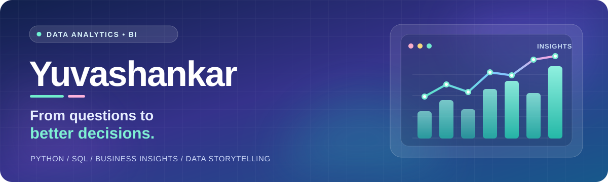
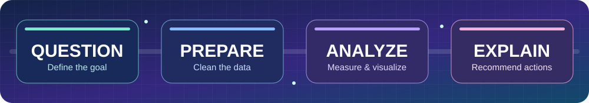

 

### Hello, I'm Yuvashankar 👋

**Aspiring Data Analyst · B.Tech in Computer Science (AI & Data Science)**

I turn messy questions into structured analysis, clear visualizations, and useful business insights.

---

### ✨ What I'm focused on

> **Business question → Clean data → Explore → Measure KPIs → Visualize → Recommend**

I am building the skills to analyze business performance, explain *why* metrics change, and present findings that decision-makers can use. This profile is a living record of that journey.

### 🧰 My analytics toolkit

**Data & analysis**

**Business intelligence & visualization**

**Methods & workflow**

Tools and subjects I'm learning and practicing — this is a roadmap, not a claim of mastery.

---

### 📊 Portfolio roadmap

<table>
<tr>
<td width="33%" valign="top">
<h4>🛍️ Retail Analytics</h4>
Planned case study  
Explore sales, revenue trends, margins, and the KPIs that matter to a retail team.
</td>
<td width="33%" valign="top">
<h4>👥 Customer Insights</h4>
Planned case study  
Use segmentation and retention analysis to understand customer behavior.
</td>
<td width="34%" valign="top">
<h4>📈 BI Dashboard</h4>
Planned case study  
Design a clear performance dashboard with documented metrics and business takeaways.
</td>
</tr>
</table>

**Every completed project will include:** business objective · dataset source · cleaning steps · reproducible analysis · KPIs · visuals · findings · limitations · recommendations.

*Project links will appear here once the work is complete. I prefer meaningful analysis over placeholder repositories.*

### 🌱 Currently learning

- 🐍 **Python:** data manipulation, cleaning, and exploratory analysis
- 🗃️ **SQL:** joins, aggregations, CTEs, and analytical queries
- 📊 **Excel & Power BI:** modeling, DAX, dashboards, and KPI reporting
- 🧠 **Statistics & business thinking:** hypotheses, metrics, and clear storytelling

### 🎯 How I work with data

**Question → Prepare → Analyze → Explain.** For every case study, I'll describe the business problem, methods, evidence, limitations, and recommendations.

---

### Let's make data understandable.

**Curiosity · Clarity · Consistency**

Built with a mobile-friendly banner, accessible text, and a focus on substance over decoration.

